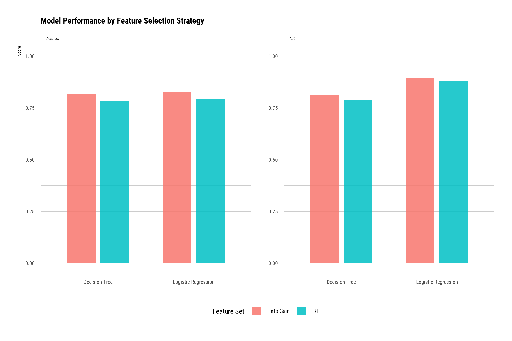
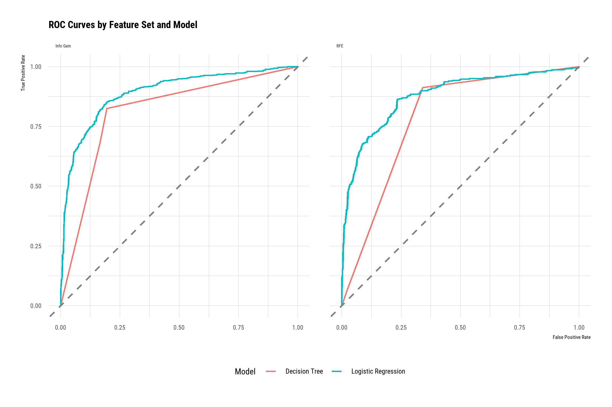
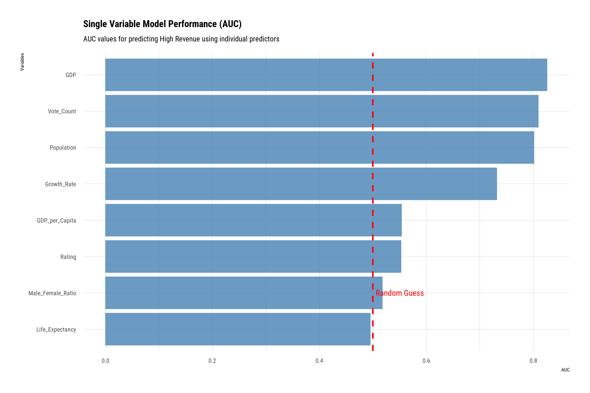
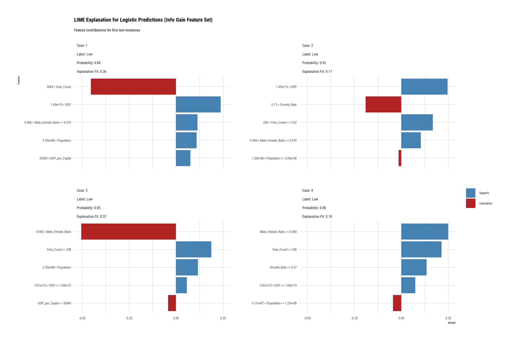

# Box Office Revenue Prediction

Classifying films as High or Low box-office revenue relative to their production country's GDP, with an R Markdown report and a Shiny app.

## Summary

This project classifies films released between 2000 and 2024 as High or Low box-office revenue relative to the GDP of their production country. It consists of an R Markdown report (`report.Rmd`, rendered as `report.html`) and an interactive Shiny app (`app.R`) covering data exploration, feature selection, model training, evaluation and prediction. It was an individual project for the Computational Data Analysis unit at the University of Western Australia (UWA) in 2025.

## Question

> Predict whether a movie will generate High or Low revenue relative to its production country's economic context.

## Data sources

| File | Source | Licence | Included |
|------|--------|---------|----------|
| `GDP_2020_2024.csv` | [World Bank, GDP (current US$)](https://data.worldbank.org/indicator/NY.GDP.MKTP.CD) | CC BY 4.0 | Yes |
| `Population_2000_2024.csv` | [US Census Bureau, International Database](https://www.census.gov/data-tools/demo/idb/) | Public domain | Yes |
| `Box_office_data(2000-2024).csv` | [Kaggle, "Movies Box office Dataset (2000-2024)"](https://www.kaggle.com/datasets/aditya126/movies-box-office-dataset-2000-2024) (Box Office Mojo revenue, TMDB ratings) | Database: Open Database, Contents: © Original Authors | No |

The box-office file is not redistributed. [data/README.md](data/README.md) describes each file and how to recreate the missing one.

## Methods

- **Cleaning:** `"--"` placeholders are converted to `NA`, and numeric columns are parsed (thousands separators and the `/10` rating suffix removed). The comma-separated `Production_Countries` field is split so each film has one row per production country. "United States of America" is harmonised to "United States" across the three datasets.
- **Joins:** GDP is reshaped from wide (one column per year) to long format. Film rows are joined to GDP and population on country and year.
- **Target:** relative revenue is worldwide revenue divided by the production country's GDP. Films above the median relative revenue are labelled High, the rest Low.
- **Candidate features:** `Rating`, `Vote_Count`, `GDP`, `Population`, `GDP_per_Capita`, `Growth_Rate` (annual population growth rate), `Life_Expectancy` and `Male_Female_Ratio`.
- **Screening:** numeric predictors with absolute pairwise correlation above 0.9 are removed (`caret::findCorrelation`). Each candidate is scored on its own with a single-variable logistic regression (AUC and deviance reduction).
- **Feature selection:**
  - Information gain (`FSelectorRcpp::information_gain`).
  - Recursive feature elimination (`caret::rfe`, 5-fold CV). The report ranks features with random forest (`rfFuncs`), while the app uses logistic regression (`lrFuncs`).
- **Modelling:** for each feature set (Info Gain and RFE), classes are balanced by downsampling the majority class, and the data is split 70/30 into training and test sets. Models are trained with `caret` using 5-fold cross-validation (ROC metric). The two models are logistic regression (`glm`, binomial) and a decision tree (`rpart`).
- **Evaluation:** test-set accuracy, AUC (`pROC`), deviance and deviance reduction relative to a null model. LIME (`lime`) explanations are produced for the logistic regression model with Info Gain features.

## Results

Test-set results printed in `report.html` (section 7):

| Feature set | Model | Accuracy | AUC |
|-------------|-------|----------|-----|
| Info Gain | Logistic regression | 0.8262 | 0.8920 |
| Info Gain | Decision tree | 0.8146 | 0.8129 |
| RFE | Logistic regression | 0.7951 | 0.8780 |
| RFE | Decision tree | 0.7855 | 0.7863 |

Logistic regression with Info Gain features performed best. Its cross-validated AUC was 0.8769. The narrative text in section 7 of the report quotes RFE figures from an earlier run (logistic regression 0.7883 / 0.8656, decision tree 0.7555 / 0.7647). The table above uses the printed model output, which matches the figures below.

GDP appears both in the target (revenue / GDP) and as a predictor, and vote counts accrue after release, so the model explains a film's revenue class rather than forecasting it before release.

Model performance by feature selection strategy:

ROC curves by feature set and model:

Single-variable AUC for each candidate predictor:

LIME explanations for the logistic regression model (Info Gain features):

## How to run

Requires R 4.6.1, the version recorded in `renv.lock`, and RStudio.

1. Clone the repository and open `box-office-revenue-prediction.Rproj` in RStudio.
2. Run `renv::restore()` to install the package versions recorded in `renv.lock`.
3. Add `data/Box_office_data(2000-2024).csv` as described in [data/README.md](data/README.md).
4. Open `app.R` and click **Run App**. The app trains its models when a session starts, so the first load takes a while. Startup also needs an internet connection to download Google Fonts.
5. To read the report, download `report.html` and open it in a browser. GitHub does not render it. Re-knitting `report.Rmd` is optional, and results may differ slightly with newer package versions.

`CDA_Project_Draft.R` is the earlier draft script for the analysis. It reads the CSV files from the working directory rather than `data/`.

## Screenshots

## Live links

- Video walkthrough of the app: https://youtu.be/5-fc6ZMSyW0
- There is no hosted demo. The app runs locally.

## AI assistance

- Helper functions in `report.Rmd` marked `# Source: OpenAI` / `# Model: GPT-5` were generated with GPT-5.
- `app.R` reuses eight of them: `clean_numeric`, `logLikelihood`, `add_single_prob_column`, `evaluate_single_variable`, `plot_model_performance`, `plot_model_rocs`, `plot_confusion_matrices` and `summarise_deviances`.
- This repository's packaging and README were prepared with Claude Code.
